<p align="center">
  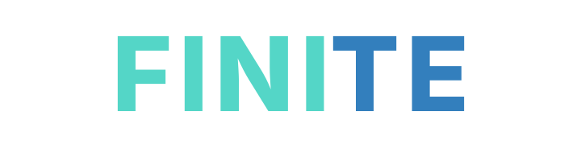
</p>

<p align="center"><strong>One shared limit for the short-video feeds you choose.</strong><br>FINITE helps you set a daily boundary across Instagram Reels and YouTube Shorts while keeping the rest of the app usable.</p>

<p align="center">
  <a href="https://github.com/Mazin7d4/FINITE-Hackathon/releases/tag/v0.1.6"></a>
  <a href="LICENSE"></a>
  
  <a href="https://github.com/Mazin7d4/FINITE-Hackathon/releases/tag/v0.1.6"></a>
</p>

Verified locally: TypeScript + 16 JS + 61 Kotlin + `assembleRelease` passed.

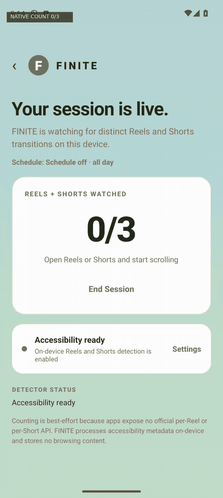

> Evidence: Real Android emulator footage: FINITE counter, Shorts scrolling, native limit overlay. [Download the release demo](https://github.com/Mazin7d4/FINITE-Hackathon/releases/download/v0.1.5/finite-demo-short.mp4).

## Watch FINITE in action

https://github.com/user-attachments/assets/7b8e0580-d50e-416d-8863-a65d13ad5b74

## See it in three steps

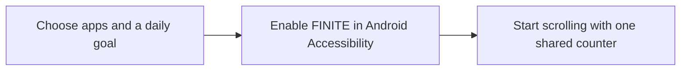

## Gallery

<p align="center">
  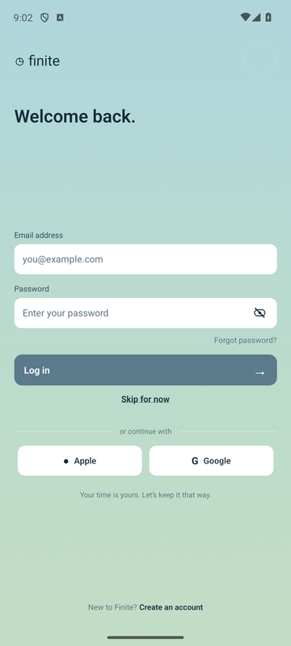
  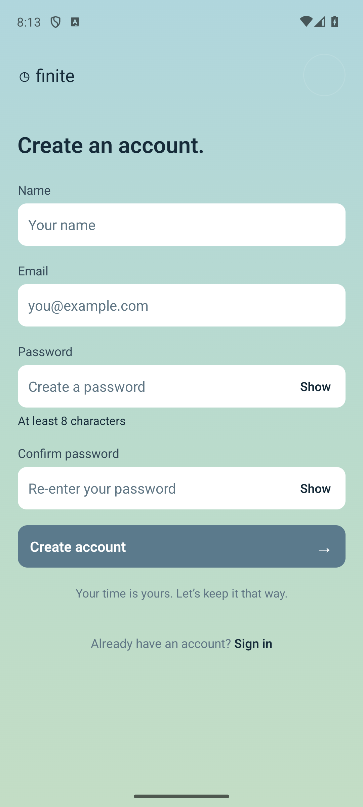
  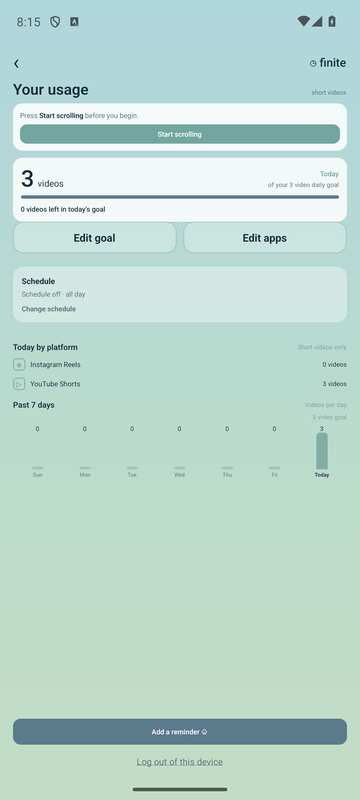
</p>
<p align="center">
  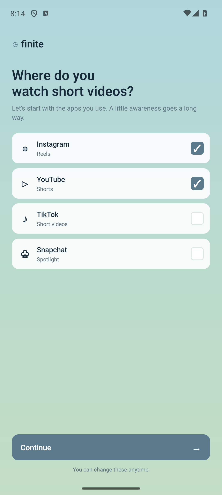
  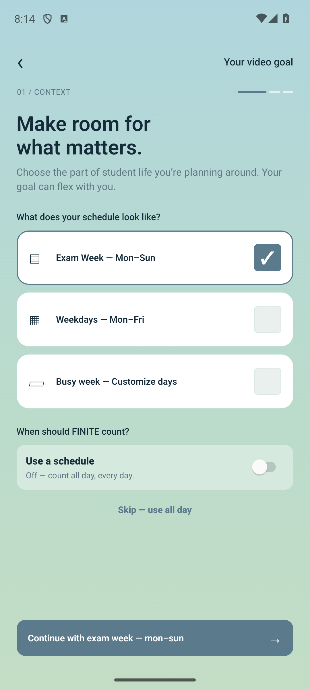
  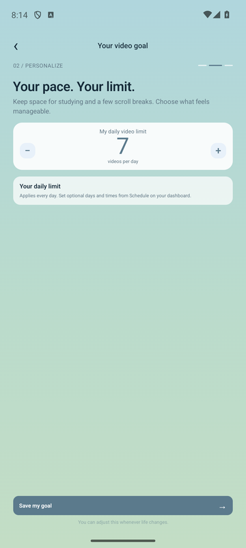
  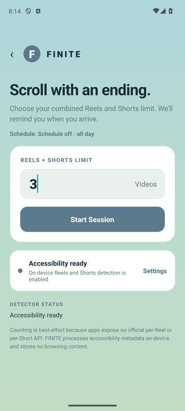
  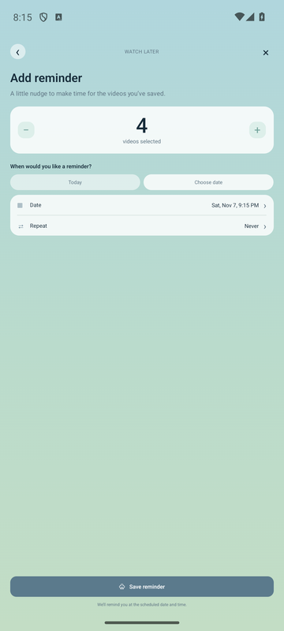
  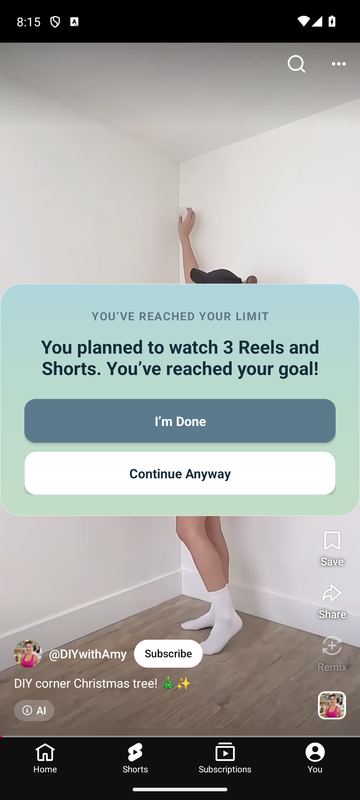
</p>

## Install v0.1.6

**[Download the Android APK](https://github.com/Mazin7d4/FINITE-Hackathon/releases/download/v0.1.6/finite-v0.1.6.apk)** · [release notes](https://github.com/Mazin7d4/FINITE-Hackathon/releases/tag/v0.1.6)

1. Download `finite-v0.1.6.apk` on Android and allow your browser or Files app to install it when prompted.
2. Open FINITE and tap **Skip for now** for an account-free setup, or create an optional local account; then choose Instagram and/or YouTube and set a daily goal.
3. Optional scheduling is off by default; when it is off, the limit applies all day. Enable Android notification permission if you want reminder notifications.
4. Tap **Enable** and turn on FINITE in Android Accessibility settings. Return to FINITE and tap **Start scrolling**.

## What is here

- One shared daily counter for Instagram Reels and YouTube Shorts.
- Selective tracking: short-video feeds are limited; messaging remains usable.
- Editable goal, selected apps, optional schedule, reminders, dashboard, and usage history.
- Native limit overlay with **I'm Done** and **Continue Anyway** actions.
- Optional app-local accounts and profile storage; **Skip for now** provides an account-free alternative, and there is no backend account service.
- Device-local state: goals, sessions, counts, and acknowledgements stay on the device.

Counting is best effort. Instagram and YouTube do not expose an official per-video transition API, so FINITE combines conservative Android accessibility signals, viewer checks, scroll qualification, and debounce logic.

## Architecture

```text
React Native / TypeScript UI
        │  FiniteNative bridge + state events
        ▼
Kotlin session module ── SharedPreferences / SessionStore
        │
        ▼
Android AccessibilityService
   ├── ReelDetector      ─┐
   └── ShortsDetector     ├── shared increment policy → native overlay
                          ┘
```

The bridge owns session lifecycle and launch selection. The accessibility service observes only the selected apps while a session is active; both detectors feed the same native `SessionStore.increment()` path. The React Native dashboard subscribes to native state updates, so the counter and overlay share one source of truth.

## Quick start

Requirements: Node.js 24, JDK 17, Android SDK 37, NDK `27.1.12297006`, and CMake 3.22.1.

```bash
npm ci
npx tsc --noEmit
npm test -- --runInBand
```

Android unit tests:

```bash
cd android
./gradlew testDebugUnitTest
```

### For UI devs (Expo)

```bash
npm install
npx expo run:android
```

After the native dev build exists, `npx expo start` reloads JavaScript changes. Expo Go is not the target because FINITE includes custom Kotlin accessibility and bridge code. New screens live in `src/screens/`; `App.tsx` owns the entry flow. UI work generally needs Android Studio's SDK and JDK 17, not changes to the Kotlin detectors.

Useful package scripts are `npm start`, `npm run android`, `npm run web`, `npm test`, and `npm run lint`. The release APK is built with `npm run android:apk` on Windows or `cd android && ./gradlew assembleRelease` on macOS/Linux.

## Roadmap

- Keep detector rules resilient as Instagram and YouTube accessibility trees evolve.
- Expand review and reminder insights without weakening the one-shared-limit model.
- Improve onboarding clarity and motion while preserving the calm, low-friction flow.
- Add more automated integration coverage around bridge state transitions.

## License

MIT. See [LICENSE](LICENSE).
